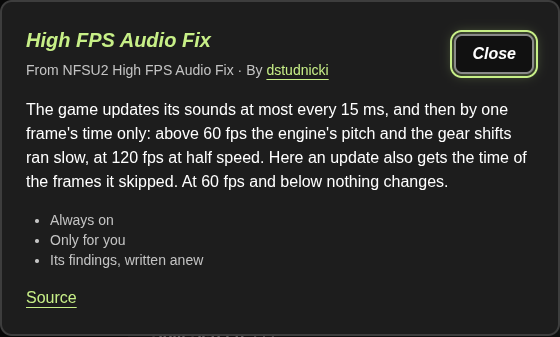
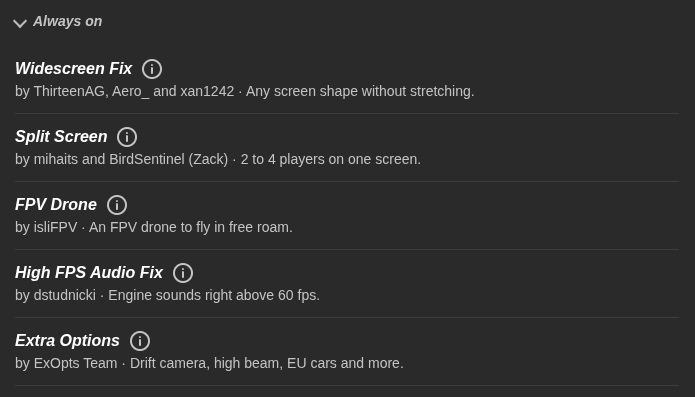

# NFSU2 High FPS Audio Fix — Installation

Audio timing fix for Need for Speed Underground 2. The same ASI plugin is intended for Windows and Wine/Proton.
## Installation

1. Close the game.
2. Copy `NFSU2HighFPSAudioFix.asi` and `NFSU2HighFPSAudioFix.ini` into the game's `scripts` folder.

## How it works

The original audio manager skips updates until more than 15 ms have elapsed, but then receives only the current frame's elapsed time. At high frame rates, some elapsed time is therefore lost, which can stretch out the gear-change sound.

The fix accumulates elapsed time across frames and passes the total when the audio manager actually updates. It does not cap FPS, change driving physics, or modify the executable on disk. It patches two calls in memory and resets the accumulated time during pauses and loading. Since it affects the audio manager, longer tests should also check other sound effects.

## Disabling the fix and compatibility

Close the game, set `Enabled = 0`, or move the ASI file out of `scripts`, then restart the game. You do not need to restore the executable. The ASI plugin itself does not write career saves, but the game can still save the active profile normally.

## Usage in Underground 2 Revived

This fix is currently used in the Underground 2 Revived project. It is listed in the Mods section as a fix for the gear-shifting audio issue that can occur when playing at high FPS.

  
  

